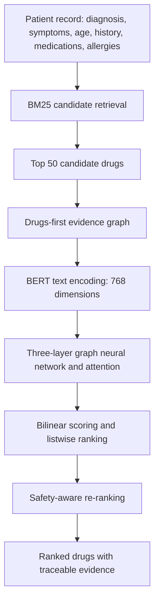

# 💊 IntelliRx
### Robust Medication Recommendation System with Advanced Representation Learning

**Senior Design Project · Fall 2026/2027 · University of Sharjah**

**Team:** Sara Al Zaben · Maryam Ali · Amna Almazrouei  
**Supervisor:** Dr. Ayad Turky  
**College:** College of Computing and Informatics

> **Research prototype only.** IntelliRx is intended to support clinical research and clinician review, not to prescribe medication or replace professional judgment. Results are based on synthetic data.

## Overview

IntelliRx extends **TraceDR**, a traceable drug recommendation framework built around medical knowledge graphs, BERT representations and graph neural networks. It aims to rank relevant candidate drugs, account for patient-specific safety constraints, and provide supporting graph evidence for each recommendation.

### Key contributions

| TraceDR limitation | IntelliRx improvement |
|---|---|
| A node-limited graph may omit many candidate drugs | **Drugs-first graph:** reserve space for all 50 candidates before adding evidence |
| Independent node scoring does not directly optimize the drug ranking | **Listwise loss:** train candidate drugs to compete in a ranking objective |
| Safety is measured but not incorporated in the final ranking | **Safety-aware re-ranking:** demote drugs with known interactions, group cautions or allergy conflicts |

## System architecture

The safety layer checks documented **drug–drug interactions**, **patient-group cautions**, and **ingredient/allergy conflicts**. These checks depend on the completeness of the available knowledge graph and should not be treated as comprehensive clinical safety screening.

## Dataset

The project uses **DrugRec**, a synthetic patient dataset associated with TraceDR, containing Chinese-language records. The presentation describes an exploratory subset of **800 patients** (480 training, 160 validation, 160 test). Separately, the reported comparison results were evaluated on **1,000 held-out test patients**. These two figures refer to different described analyses and should not be conflated.

Patient attributes include diagnosis, symptoms, medical history, current medication, allergies, age and patient group. Raw datasets are **not included** in this repository package.

## Reported experimental results

The following results are transcribed from the senior project presentation; this documentation package does **not** independently reproduce them.

| Metric | TraceDR baseline | IntelliRx | Direction |
|---|---:|---:|---|
| Precision@1 | 0.391 | **0.541** | Higher is better |
| MRR | 0.508 | **0.640** | Higher is better |
| Hit@5 | 0.666 | **0.769** | Higher is better |
| F1@5 | 0.240 | **0.285** | Higher is better |
| Jaccard | 0.166 | **0.199** | Higher is better |
| DDI | 0.039 | **0.003** | Lower is better |
| Group caution | 0.020 | **0.003** | Lower is better |
| CMS (unsafe drug in top 5) | 0.059 | **0.006** | Lower is better |

**Headline:** Precision@1 increased from **39.1% to 54.1%**, while the reported CMS rate decreased from **5.9% to 0.6%**.
